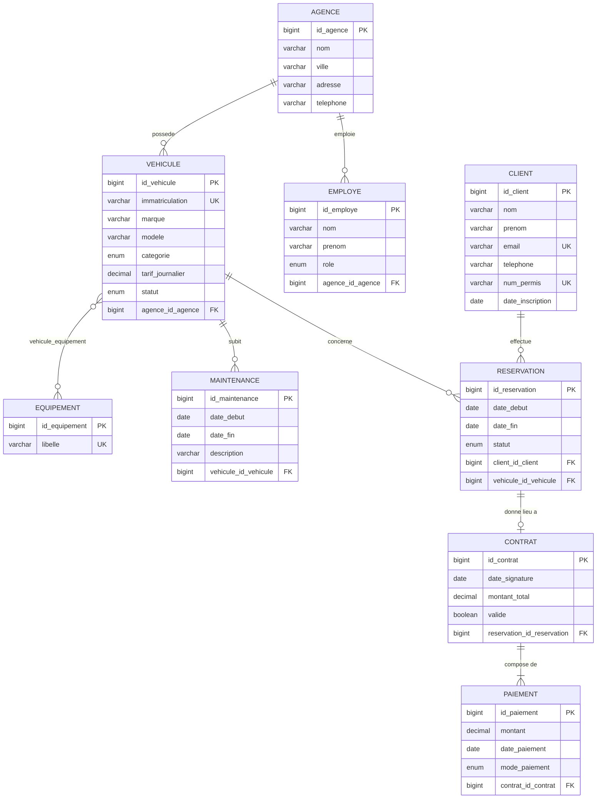
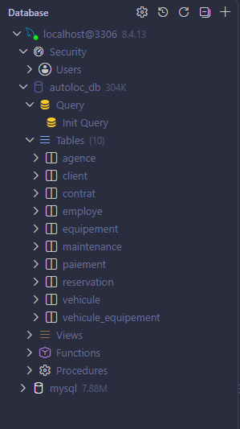
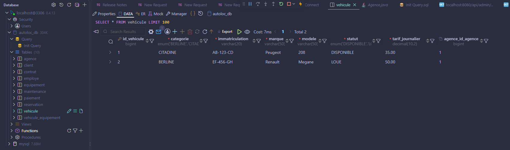
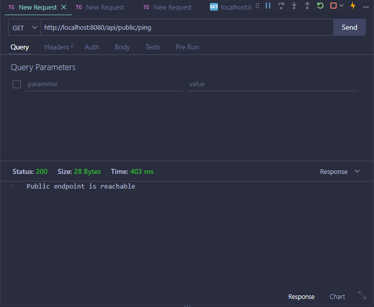
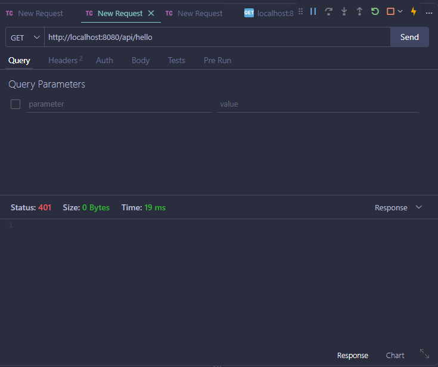
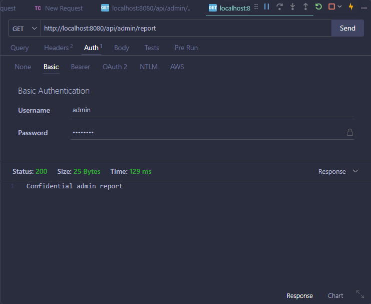
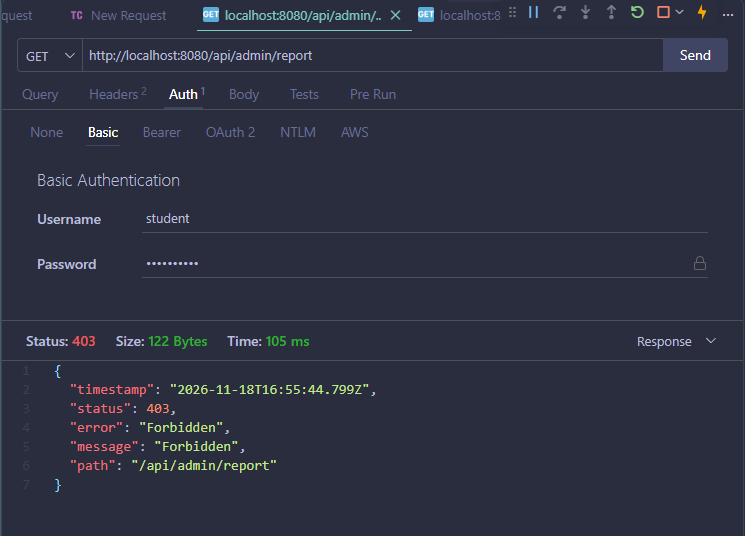
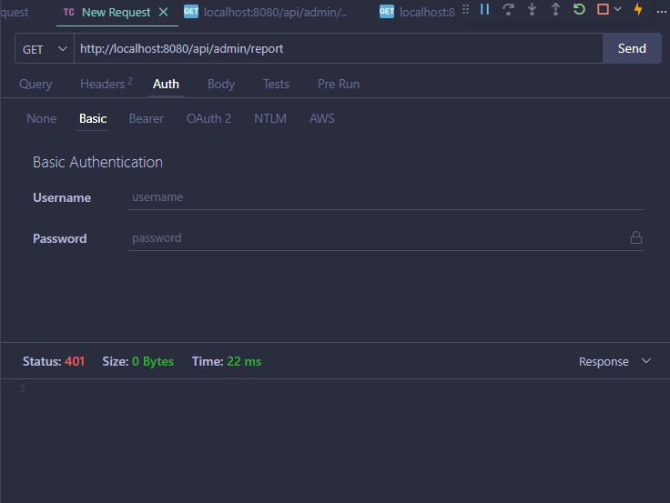

# AutoLoc — Workshop 1 (ASI 26·27)

Spring Boot REST API for a car rental agency: JPA model, associations (cascade / fetch) and
Spring Security. The project lives in [`autoloc-api/`](autoloc-api).

**Stack:** Java 17+ · Spring Boot 4 · Spring Data JPA / Hibernate · MySQL 8 · Lombok · Spring Security · Maven

## Run the project

1. Start a MySQL server on `localhost:3306` (the `autoloc_db` database is created automatically).
2. Set the database password as an environment variable (it is not stored in the repository):
   ```powershell
   $env:DB_PASSWORD = "your_mysql_password"   # DB_USERNAME defaults to root
   ```
3. From `autoloc-api/`:
   ```powershell
   .\mvnw.cmd spring-boot:run
   ```
4. The console shows `Started AutolocApiApplication` and the `create table …` DDL generated by Hibernate.

Tests (`.\mvnw.cmd test`) run against an in-memory H2 database, so they don't need MySQL.

## What was done

| Part of the subject | Where |
|---|---|
| Spring Boot + Maven project, `application.properties` (password via env variable, SQL logs at DEBUG) | [`pom.xml`](autoloc-api/pom.xml), [`application.properties`](autoloc-api/src/main/resources/application.properties) |
| Package structure: `domain`, `repository`, `service`, `web.controller`, `web.dto` | [`fr/ece/autoloc`](autoloc-api/src/main/java/fr/ece/autoloc) |
| `Vehicule` entity + `StatutVehicule`, `CategorieVehicule` | [`domain/`](autoloc-api/src/main/java/fr/ece/autoloc/domain) |
| Homework: 8 remaining entities + `RoleEmploye`, `StatutReservation`, `ModePaiement` | [`domain/`](autoloc-api/src/main/java/fr/ece/autoloc/domain) |
| Contrat ↔ Paiement (bidirectional, `mappedBy`, `CascadeType.ALL`, `orphanRemoval`, LAZY) | [`Contrat.java`](autoloc-api/src/main/java/fr/ece/autoloc/domain/Contrat.java), [`Paiement.java`](autoloc-api/src/main/java/fr/ece/autoloc/domain/Paiement.java) |
| The 7 remaining associations | entities in [`domain/`](autoloc-api/src/main/java/fr/ece/autoloc/domain) |
| Fetch / cascade justification | [`docs/fetch-strategy.md`](autoloc-api/docs/fetch-strategy.md) |
| Spring Security (2 in-memory users, BCrypt, route rules) | [`SecurityConfig.java`](autoloc-api/src/main/java/fr/ece/autoloc/config/SecurityConfig.java), [`SecurityDemoController.java`](autoloc-api/src/main/java/fr/ece/autoloc/web/controller/SecurityDemoController.java) |
| Answers to the security questions | [`docs/security-notes.md`](autoloc-api/docs/security-notes.md) |

Java identifiers are kept in French (as in the subject's `Vehicule` example) for consistency.
Lombok: targeted `@Getter` / `@Setter` / `@NoArgsConstructor` / `@AllArgsConstructor`, no `@Data`
on entities (avoids recursion in bidirectional associations).

## Generated database schema



9 entity tables + 1 join table:

`agence`, `client`, `contrat`, `employe`, `equipement`, `maintenance`, `paiement`, `reservation`,
`vehicule`, `vehicule_equipement`

| Association | Owning side / FK | Fetch | Cascade |
|---|---|---|---|
| Contrat 1 — * Paiement | `paiement.contrat_id_contrat` | LAZY | ALL + orphanRemoval |
| Agence 1 — * Vehicule | `vehicule.agence_id_agence` | LAZY | none |
| Agence 1 — * Employe | `employe.agence_id_agence` | LAZY | none |
| Vehicule * — * Equipement | join table `vehicule_equipement` | LAZY | none (`Set`) |
| Client 1 — * Reservation | `reservation.client_id_client` | LAZY | PERSIST |
| Reservation * — 1 Vehicule | `reservation.vehicule_id_vehicule` | LAZY | none |
| Reservation 1 — 0..1 Contrat | `contrat.reservation_id_reservation` (unique) | LAZY | ALL (Reservation side) |
| Vehicule 1 — * Maintenance | `maintenance.vehicule_id_vehicule` | LAZY | PERSIST |

### Checking the database

Connect any MySQL client (MySQL Workbench, DBeaver…) to `localhost:3306`, database `autoloc_db`:

```sql
SHOW TABLES;
DESCRIBE vehicule;
```

The application creates the tables but no data. To try the associations with some rows, run
[`docs/sample-data.sql`](autoloc-api/docs/sample-data.sql) (one agency, two vehicles, a client,
a reservation, its contract and two payments).

**Tables generated in `autoloc_db`**



**`vehicule` table with the sample data (columns, types and the `agence_id_agence` foreign key)**



## Spring Security — test results

Accounts (classroom only): `student` / `student123` (role USER), `admin` / `admin123` (role ADMIN). HTTP Basic.

| Request | Anonymous | USER | ADMIN |
|---|---|---|---|
| `GET /api/public/ping` | 200 | 200 | 200 |
| `GET /api/hello` | 401 | 200 | 200 |
| `GET /api/admin/report` | 401 | 403 | 200 |

### Screenshots

**`GET /api/public/ping` — anonymous → 200**



**`GET /api/hello` — anonymous → 401**



**`GET /api/admin/report` — admin → 200**



**`GET /api/admin/report` — student (USER) → 403**



**`GET /api/admin/report` — anonymous → 401**


